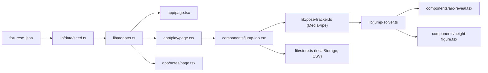

# Saltara

Saltara measures a vertical jump in centimetres from a laptop webcam, using the curve of the jumper's own flight as the ruler: no mat, no force plate, no tape measure, no calibration. It is built for PE teachers with no equipment budget, because force plates and contact mats cost hundreds to thousands of dollars and most school lessons end up with a chalk mark on the wall or no measurement at all.

**Live:** https://saltara.vercel.app. Start at DEMO step 1: open `/` and move the pointer over the arc.

The live URL runs the real solver on your camera; the 12 class 9B jumps are seeded and labelled "seeded", and the pilot rows on `/notes` are labelled placeholder.

## Try it in 60 seconds

1. Open `/` and move the pointer (or the arrow keys) over the arc: the sun dot slides along the fitted parabola and the sentence under it reads the hip height in centimetres.
2. Scroll to the chapters and throw the deck of seeded jumps; the figure and every number in the chapter text follow the card you land on.
3. Open `/play`, pick "Seeded jumps", then j-02 (Elif Kaya, try 2).
4. Press "Live camera", then "Start camera", stand two metres back, wait a second and jump.
5. Save the result to a student and press "Download CSV".

## How it works

While the body is in the air, its centre of mass follows a parabola with a known acceleration: g = 9.81 m/s². Saltara uses that fact twice.

1. **Tracking.** MediaPipe Pose Landmarker follows the hips and ankles on every webcam frame, and the media element's per-frame callback (rVFC) gives each frame its real timestamp, so a dropped frame does not bend the curve.
2. **The gravity ruler.** Saltara fits `y = at² + bt + c` to the hip height across the 10 to 18 airborne frames. In image pixels, `a = (g/2) × s`, so the curvature gives the scale `s` in pixels per metre with nothing in the frame to calibrate against.
3. **Three heights, side by side.** Frame counting (`h = gT²/8` from the airborne frame count), parabola flight time (the reported number: the fitted roots land between frames), and standing hip to apex (the rise converted with the gravity scale, which includes the heel raise like a wall-reach test).

Jumps with fewer than 6 airborne frames, an R² under 0.9, or hidden feet are rejected with a typed code and a plain reason. If the shoulder width changes by more than 5 percent, the jumper moved toward or away from the camera, and the height is kept but marked. Every gate lives in `lib/config.ts`.

## Architecture



## Quickstart

```bash
npm install
npm run dev      # http://localhost:3000 (the camera needs HTTPS or localhost)
npm test         # Vitest: solver, plot geometry, schemas and the class store
npm run proof    # solves the 12 seeded jumps, runs the tests, checks the engine URLs, rewrites the Proof section
```

No secrets are needed (see `.env.example`). `ADAPTER_MODE` defaults to `fake`, which opens `/play` on the seeded class 9B replay; `real` opens it on the live camera. In both modes the camera and the recorded clip run the real pipeline. `npm run demo:reset`, then `/play?reset=demo`, restores the demo class.

## Addresses

| Item | Value |
| --- | --- |
| Live app | https://saltara.vercel.app |

## Prize categories we enter

PhysTech 2027 lists no sponsor bounty; these are the organiser's categories this build targets.

| Bounty | Prize | Slots | Required tech | Code file | DEMO step |
| --- | --- | --- | --- | --- | --- |
| Grand Prix (1st Place) | Certificate of achievement; Will be invited to publish a book chapter about the project (priceless achievement!). | 1 | none stated | `lib/jump-solver.ts` | 4 |
| Excellence in Social Impact Award | Certificate of achievement; Will be invited to publish a book chapter about the project (priceless achievement!). | 2 | none stated | `components/class-roster.tsx` | 5 |
| Excellence in Research Award | Certificate of achievement; Will be invited to publish a book chapter about the project (priceless achievement!). | 2 | none stated | `app/notes/page.tsx` | 6 |
| Excellence in Innovation Award | Certificate of achievement; Will be invited to publish a book chapter about the project (priceless achievement!). | 2 | none stated | `lib/jump-solver.ts` | 3 |

## Tech stack

- Next.js 15 (App Router), React 19, TypeScript strict, Tailwind CSS v4, shadcn-style primitives
- `@mediapipe/tasks-vision` 0.10.21 (WASM runtime from cdn.jsdelivr.net, model from storage.googleapis.com, no key)
- `@react-spring/web` 10 and `@use-gesture/react` 10: the throwable deck of seeded jumps, the overshooting cm figure, and the pointer pull and tilt on the hero arc
- zod 3 validates the picked clip and the collected samples before the solver sees them
- Vitest 3 for the tests, `tsx` for the proof script
- Charts are hand-drawn SVG, so they render on the server and follow the design tokens
- Browser APIs: the per-frame callback (rVFC), `getUserMedia`, Screen Wake Lock, `localStorage`
- Deployed on Vercel, no database

## Proof

`npm run proof` rewrites the three blocks below with measured numbers. A block that could not run says so.

### Solver on the seeded jumps

<!-- PROOF:BEGIN solver -->
Sample data: the 12 seeded jumps of Year 9 PE, class 9B (synthetic traces rebuilt by `traceFor`), solved by `analyzeJump` in Node.

| id | true rise cm | headline cm | error cm | true px/m | gravity px/m | ms |
| --- | --- | --- | --- | --- | --- | --- |
| j-01 | 31.8 | 32.0 | 0.2 | 410 | 407 | 0.90 |
| j-02 | 33.9 | 33.6 | -0.3 | 412 | 416 | 0.27 |
| j-03 | 27.6 | 27.5 | -0.1 | 388 | 391 | 0.15 |
| j-04 | 29.1 | 28.9 | -0.2 | 391 | 396 | 0.11 |
| j-05 | 39.2 | 38.8 | -0.4 | 436 | 440 | 2.34 |
| j-06 | 37.1 | 37.1 | -0.0 | 433 | 433 | 0.11 |
| j-07 | 24.4 | 25.6 | 1.2 | 402 | 378 | 0.07 |
| j-08 | 26.2 | 27.2 | 1.0 | 405 | 389 | 0.05 |
| j-09 | 30.1 | 30.7 | 0.6 | 421 | 413 | 0.08 |
| j-10 | 28.9 | 29.6 | 0.7 | 418 | 409 | 0.04 |
| j-11 | 35.2 | 34.9 | -0.3 | 377 | 382 | 0.04 |
| j-12 | 36.8 | 36.1 | -0.7 | 380 | 386 | 0.04 |

Mean absolute error: 0.48 cm over 12 solved jumps (0 rejected). Median solver latency: 0.09 ms.
<!-- PROOF:END solver -->

### Tests

<!-- PROOF:BEGIN tests -->
`npx vitest run` on `tests/`: 19 passed, 0 failed, 19 total.
<!-- PROOF:END tests -->

### Engine files

<!-- PROOF:BEGIN engine -->
HEAD requests from the proof run to the URLs in `lib/pose-tracker.ts`:

| url | status | ms |
| --- | --- | --- |
| https://cdn.jsdelivr.net/npm/@mediapipe/tasks-vision@0.10.21/wasm/vision_wasm_internal.js | 200 | 112 |
| https://cdn.jsdelivr.net/npm/@mediapipe/tasks-vision@0.10.21/wasm/vision_wasm_internal.wasm | 200 | 58 |
| https://storage.googleapis.com/mediapipe-models/pose_landmarker/pose_landmarker_lite/float16/1/pose_landmarker_lite.task | 200 | 145 |
<!-- PROOF:END engine -->

## Honest status

The twelve demo jumps of class 9B are seeded synthetic traces: physically correct flights with webcam-like landmark jitter, so the solver can be shown without a camera. The 22 pilot rows on `/notes` are labelled placeholder on screen; our own wall-mark session (2 jumpers, at least 20 jumps, chalk jump-and-reach and tape against the three Saltara estimates) replaces them.

## AI use

The PhysTech 2027 rules state no policy on AI use. Saltara was built with an AI coding agent (Claude Code) writing most of the code under the builder's direction; the method (gravity as the scale), the product decisions and the review of every change are the builder's.

## License

MIT, see LICENSE.
